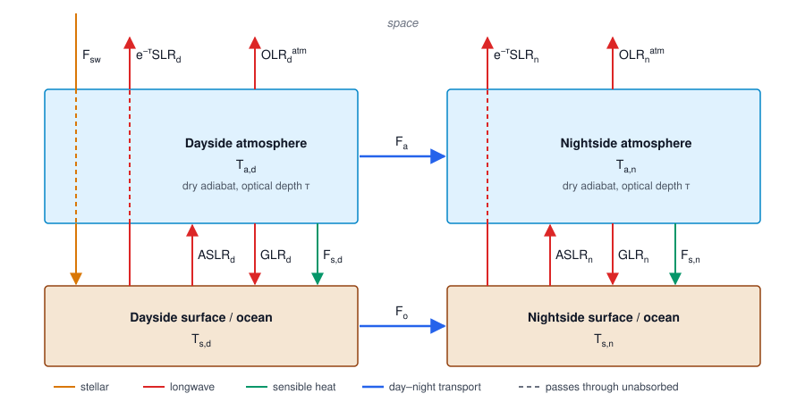

# Two-column model with an optically thick atmosphere

Extends the four-box model of Wirth, Powell & Wordsworth (2026, hereafter W26) from the optically thin limit to arbitrary
longwave optical depth, using the grey radiative-convective column of Koll & Abbot (2016, hereafter KA16, Section 3).
A day–night ocean heat flux is included as in `dry_planet`.

The full closed system is summarised in [Section 10](#10-summary-the-closed-system). Sections 2–6 derive the four
energy budgets. The fifth equation, which fixes the surface wind, is a heat-engine bound derived in
[Section 8](#8-heat-engine-closure-for-the-surface-wind). [Section 7](#7-the-fifth-equation-thermodynamics) explains
why W26's thermodynamic closure is not used. The bulk-flow parameter $\alpha$ stays free, as in W26.

## 1. Setup and notation

Four boxes: dayside surface, dayside atmosphere, nightside atmosphere and nightside surface, as in W26 Fig. 2. All
fluxes are hemispheric averages in W m⁻².

*Figure 1. Energy fluxes in the four-box model. Each arrow points in the positive direction of its flux; for example,
$F_{s,d}$ and $F_{s,n}$ are positive from atmosphere to surface. The atmosphere is transparent to stellar radiation,
so $F_{sw}$ reaches the dayside surface directly. Surface emission splits into a part absorbed by the atmosphere
($\mathrm{ASLR}$) and a part transmitted to space ($e^{-\tau}\mathrm{SLR}$). Dashed segments mark where a flux crosses
the atmosphere without being absorbed. The budgets are given in Section 3, and each flux in nondimensional form in
Section 10.*

| Symbol | Meaning |
|---|---|
| $T_{s,d}, T_{a,d}, T_{a,n}, T_{s,n}$ | dayside surface, dayside near-surface air, nightside near-surface air, nightside surface temperatures |
| $F_{sw}$ | absorbed stellar flux at the dayside surface |
| $\mathrm{SLR}$ | surface longwave emission, $\sigma T_s^4$ |
| $\mathrm{ASLR}$ | part of SLR absorbed by the atmosphere |
| $\mathrm{OLR}^{atm}$ | longwave emitted to space by the atmosphere |
| $\mathrm{OLR}$ | total top-of-atmosphere longwave, $e^{-\tau}\,\mathrm{SLR} + \mathrm{OLR}^{atm}$ |
| $\mathrm{GLR}$ | downward longwave at the surface |
| $F_{s,d}, F_{s,n}$ | sensible heat flux, positive from atmosphere to surface |
| $F_a$ | bulk atmospheric transport, positive from day to night |
| $F_o$ | ocean (magma) transport, positive from day to night |
| $\tau$ | total longwave optical depth, $\tau = 2\kappa p_s/g$ (W26 eq. 18; includes the diffusivity factor 2) |
| $\beta$ | adiabatic lapse rate in optical depth coordinates, $\beta = R/(n c_p)$; $n = 1$ here because $\kappa$ is independent of pressure |

**Change of meaning of $T_a$.** In W26, $T_a$ is the single emission temperature of a well-mixed atmosphere. Here it is
the air temperature at the base of an adiabat. This is the temperature that enters the sensible heat flux, so the
change is arguably an improvement, but it means the optically thin limit differs from W26 unless $\beta = 0$
(Section 6).

## 2. Radiative transfer through an adiabatic grey column

Following KA16, each column follows a dry adiabat anchored at its near-surface air temperature, with $\tau'$ measured
downward from the top of the atmosphere:

$$
T(\tau') = T_a\left(\frac{\tau'}{\tau}\right)^{\beta},
\qquad
\sigma T(\tau')^4 = \sigma T_a^4 \left(\frac{\tau'}{\tau}\right)^{4\beta}.
$$

A temperature jump $T_s \neq T_a$ is allowed at the surface. KA16 set $T_s = T_a$ on the dayside.

### Upward emission from the atmosphere to space

Emission at $\tau'$ is attenuated by the optical depth above it, $\tau'$:

$$
\mathrm{OLR}^{atm} = \sigma T_a^4 \int_0^{\tau}\left(\frac{\tau'}{\tau}\right)^{4\beta} e^{-\tau'}\,d\tau'
= \sigma T_a^4\, U(\beta,\tau),
\qquad
U(\beta,\tau) = \tau^{-4\beta}\,\gamma(1+4\beta,\tau),
$$

where $\gamma(a,x) = \Gamma(a,0) - \Gamma(a,x)$ is the lower incomplete gamma function.

### Downward emission from the atmosphere to the surface

Emission at $\tau'$ is attenuated by the optical depth **below** it, $\tau - \tau'$ (KA16 eq. 9c):

$$
\mathrm{GLR} = \sigma T_a^4 \int_0^{\tau}\left(\frac{\tau'}{\tau}\right)^{4\beta} e^{-(\tau-\tau')}\,d\tau'
= \sigma T_a^4\, D(\beta,\tau).
$$

This is not an incomplete gamma function. Substituting $s = \tau'/\tau$ gives
$D = \tau e^{-\tau}\int_0^1 s^{4\beta} e^{\tau s}\,ds$. Using the integral representation of Kummer's function $M$ and
Kummer's transformation $M(a,b,z) = e^{z}M(b-a,b,-z)$, this becomes

$$
D(\beta,\tau) = \frac{\tau}{1+4\beta}\; M(1;\,2+4\beta;\,-\tau),
$$

which is bounded and numerically stable for all $\tau$ (`scipy.special.hyp1f1`).

### Surface emission absorbed by the atmosphere

$$
\mathrm{ASLR} = (1 - e^{-\tau})\,\sigma T_s^4,
\qquad
\mathrm{OLR} = e^{-\tau}\sigma T_s^4 + \mathrm{OLR}^{atm}.
$$

### Limits

| | $\tau \ll 1$ | $\tau \gg 1$ |
|---|---|---|
| $U(\beta,\tau)$ | $\tau/(1+4\beta)$ | $\Gamma(1+4\beta)\,\tau^{-4\beta}$ |
| $D(\beta,\tau)$ | $\tau/(1+4\beta)$ | $1 - 4\beta/\tau$ |
| $1-e^{-\tau}$ | $\tau$ | $1$ |

Up and down emission are equal in the thin limit, as expected for grey radiation. In the thick limit the surface sees
air at $\approx T_a$ ($D \to 1$, slightly less because the air above is cooler), while space sees air from
$\tau' \sim 1$, which is colder by $\tau^{-\beta}$.

Numerical values for CO₂ ($\beta = 189/849 = 0.223$), checked against direct quadrature:

| $\tau$ | $U$ | $D$ |
|---|---|---|
| 0.1 | 0.0496 | 0.0511 |
| 1 | 0.283 | 0.385 |
| 20 | 0.0665 | 0.955 |
| 100 | 0.0159 | 0.991 |

For an isothermal column ($\beta = 0$), $U = D = 1 - e^{-\tau}$.

## 3. Energy budgets

$$
\begin{aligned}
\text{day surface:}\quad & F_{sw} + \mathrm{GLR}_d + F_{s,d} - F_o - \mathrm{SLR}_d = 0\\
\text{day atmosphere:}\quad & \mathrm{ASLR}_d - \mathrm{OLR}^{atm}_d - \mathrm{GLR}_d - F_{s,d} - F_a = 0\\
\text{night atmosphere:}\quad & \mathrm{ASLR}_n - \mathrm{OLR}^{atm}_n - \mathrm{GLR}_n - F_{s,n} + F_a = 0\\
\text{night surface:}\quad & \mathrm{GLR}_n + F_{s,n} + F_o - \mathrm{SLR}_n = 0
\end{aligned}
$$

The atmosphere budgets contain only the atmosphere's **own** emission to space. The transmitted surface flux
$e^{-\tau}\sigma T_s^4$ is never absorbed, because $\mathrm{ASLR}$ already excludes it, so it does not appear.

Summing the four budgets gives global balance, $F_{sw} = \mathrm{OLR}_d + \mathrm{OLR}_n$.

## 4. Flux parameterisations

These follow W26 eqs. 6–8 and their hemispheric averaging with the factors $\chi$ and $\xi$.

**Stellar.** $F_{sw} = \tfrac12(1-A)F$, with $F = \sigma T_{eff}^4 (R_\star/a)^2$.

**Sensible heat.** Surface pressure is uniform, so each side's density follows from the ideal gas law at its own air
temperature, $\rho = p_s/(R T_a)$. Dayside density on the dayside, nightside density on the nightside (W26 eq. 15):

$$
F_{s,d} = \chi C_D c_p \rho_d |w| (T_{a,d} - T_{s,d}) = \frac{\chi C_D c_p p_s}{R}\,|w|\left(1 - \frac{T_{s,d}}{T_{a,d}}\right),
$$

$$
F_{s,n} = \chi C_D c_p \rho_n |w| (T_{a,n} - T_{s,n}) = \frac{\chi C_D c_p p_s}{R}\,|w|\left(1 - \frac{T_{s,n}}{T_{a,n}}\right).
$$

**Bulk atmospheric transport.** Dayside density, because the advected air comes from the dayside (W26 eq. 13):

$$
F_a = \frac{R}{r_p g}\,c_p \rho_d k_T\, \xi |v|\, T_{a,d}(T_{a,d} - T_{a,n})
= \frac{p_s c_p k_T \xi}{r_p g}\,|v|\,(T_{a,d} - T_{a,n}),
$$

with $|v| = \alpha c_s = \alpha\sqrt{c_p R T_{a,d}/c_v}$ (W26 eq. 28).

**Ocean transport.**

$$
F_o = \frac{J c_o}{2\pi r_p^2}\,(T_{s,d} - T_{s,n}).
$$

`dry_planet` additionally clamps the return temperature at the solidus.

## 5. Nondimensionalisation

As in W26, scale temperatures by the maximal dayside surface temperature,
$T_{max} = T_{eff}\left(\tfrac{1-A}{2}\right)^{1/4}(a/R_\star)^{-1/2}$, so that $F_{sw} = \sigma T_{max}^4$. Define the
ratios

$$
T_{s,d} = T_0 T_{max},\quad T_{a,d} = T_0T_1T_{max},\quad T_{a,n} = T_0T_1T_2T_{max},\quad T_{s,n} = T_0T_1T_2T_3T_{max},
$$

and divide every flux by $\sigma T_{max}^4$.

Keep W26's groups unchanged so that the existing `dry_planet` attributes can be reused:

$$
W_0 = \frac{2\kappa R\,\sigma T_{max}^4}{\chi C_D c_p g},\qquad
W = \frac{|w|}{W_0},\qquad
\tilde V = \frac{\alpha\sqrt{c_p R T_{max}/c_v}}{W_0}\ \Rightarrow\ \frac{|v|}{W_0} = \tilde V (T_0T_1)^{1/2},
$$

$$
C_T = \frac{R T_{max} k_T}{r_p g},\qquad \tilde C = \frac{\xi C_T}{\chi C_D},\qquad
\tilde O = \frac{J c_o}{2\pi r_p^2 \sigma T_{max}^3}.
$$

Using $\chi C_D c_p p_s W_0 / (R\sigma T_{max}^4) = 2\kappa p_s/g = \tau$, the fluxes become

$$
\frac{F_{s,d}}{\sigma T_{max}^4} = \tau W\,(1 - T_1^{-1}),\qquad
\frac{F_{s,n}}{\sigma T_{max}^4} = \tau W\,(1 - T_3),
$$

$$
\frac{F_a}{\sigma T_{max}^4} = \tau \tilde C \tilde V\,(T_0T_1)^{3/2}(1 - T_2),\qquad
\frac{F_o}{\sigma T_{max}^4} = \tilde O\,T_0\,(1 - T_1T_2T_3).
$$

The power $3/2$ in $F_a$ is one power of $T_{a,d}$ from $F_a$ plus $\tfrac12$ from the sound speed in $|v|$. The density
$\rho_d \propto T_{a,d}^{-1}$ cancels the explicit $T_{a,d}$ prefactor.

The radiative terms are

$$
\frac{\mathrm{SLR}_d}{\sigma T_{max}^4} = T_0^4,\quad
\frac{\mathrm{ASLR}_d}{\sigma T_{max}^4} = (1-e^{-\tau})T_0^4,\quad
\frac{\mathrm{OLR}^{atm}_d}{\sigma T_{max}^4} = U\,(T_0T_1)^4,\quad
\frac{\mathrm{GLR}_d}{\sigma T_{max}^4} = D\,(T_0T_1)^4,
$$

and likewise on the nightside with $T_0T_1T_2T_3$ for the surface and $T_0T_1T_2$ for the air.

## 6. The radiative–dynamical system

With $t = e^{-\tau}$ and $U = U(\beta,\tau)$, $D = D(\beta,\tau)$ from Section 2:

$$
\begin{aligned}
\text{day surface:}\quad & 1 + D(T_0T_1)^4 + \tau W(1 - T_1^{-1}) - \tilde O T_0(1 - T_1T_2T_3) - T_0^4 = 0\\[4pt]
\text{day atmosphere:}\quad & (1-t)T_0^4 - (U+D)(T_0T_1)^4 - \tau W(1 - T_1^{-1}) - \tau\tilde C\tilde V(T_0T_1)^{3/2}(1 - T_2) = 0\\[4pt]
\text{night atmosphere:}\quad & (1-t)(T_0T_1T_2T_3)^4 - (U+D)(T_0T_1T_2)^4 - \tau W(1 - T_3) + \tau\tilde C\tilde V(T_0T_1)^{3/2}(1 - T_2) = 0\\[4pt]
\text{night surface:}\quad & D(T_0T_1T_2)^4 + \tau W(1 - T_3) + \tilde O T_0(1 - T_1T_2T_3) - (T_0T_1T_2T_3)^4 = 0
\end{aligned}
$$

These are four equations in five unknowns, $T_0, T_1, T_2, T_3, W$. The fifth equation is discussed in Section 7.

### Checks

1. **Energy conservation.** The sum of the four equations is
   $1 = t\left[T_0^4 + (T_0T_1T_2T_3)^4\right] + U\left[(T_0T_1)^4 + (T_0T_1T_2)^4\right]$,
   i.e. $F_{sw} = \mathrm{OLR}_d + \mathrm{OLR}_n$.

2. **W26 limit.** For $\beta = 0$ and $\tau \ll 1$, $U, D, 1-t \to \tau$, and the system reduces term by term to W26
   eqs. 32–35 (`r0`–`r3` in `dry_planet.residuals`). This is a good unit test for the implementation.

   For $\beta > 0$ the thin limit has $U, D \to \tau/(1+4\beta)$ instead of $\tau$. This follows from the change of
   meaning of $T_a$ (Section 1): an adiabatic column emits at an average temperature below its base temperature.

3. **Optically thick, perfect-redistribution limit.** For $\tau \gg 1$ and $T_2 = 1$, the global balance gives
   $T_{a,d}^4 = T_{max}^4/(2U)$. With $\sigma T_{max}^4 = 2\sigma T_{eq}^4$ (KA16's convention), this becomes
   $T_{a,d} = T_{eq}\,\tau^{\beta}\,\Gamma(1+4\beta)^{-1/4}$, which is Pierrehumbert's (2011) result (KA16 eq. 1).

### Modelling choices to keep in mind

- **Nightside profile.** The nightside column is taken as its own adiabat anchored at $T_{a,n}$. KA16 (Fig. 4) find
  that nightsides are stably stratified with a near-surface inversion, so an adiabat is an extreme case. A separate
  $\beta_n \in [0, \beta]$ brackets this, with $\beta_n = 0$ giving an isothermal nightside column. Only $U$ and $D$
  change: evaluate them at $\beta_n$ in the nightside equations.
- **No stratosphere.** KA16's RC model assumes convection extends to the top of the atmosphere. Their RCS model
  (Section 5) adds a radiative stratosphere, which matters most for hot or thin atmospheres.

## 7. The fifth equation (thermodynamics)

W26 close their system with the thermodynamic equation. This section examines how that closure carries over to an
optically thick atmosphere, and compares it with the alternatives. The model uses option (c), the heat engine of
Section 8.

### Starting point

W26 eqs. 36–37:

$$
\frac{DI}{Dt} + \frac{p}{\rho}\nabla\cdot\mathbf u = \mathcal H,
\qquad
\frac{\partial I}{\partial t} + u_x\frac{\partial I}{\partial x} + u_y\frac{\partial I}{\partial y} + u_z\frac{\partial I}{\partial z} + \frac{p}{\rho}\nabla\cdot\mathbf u = \mathcal H.
$$

The flow is steady and varies mainly in $x$, so $\partial_t = \partial_y = 0$. W26 also drop $\partial_z$ by appealing to
the optically thin limit, which no longer holds here.

### Vertical terms vanish on an adiabat

Combine continuity, $\nabla\cdot\mathbf u = -\rho^{-1}D\rho/Dt$, with the ideal gas law. Then

$$
c_v\frac{DT}{Dt} + \frac{p}{\rho}\nabla\cdot\mathbf u = c_p\frac{DT}{Dt} - \frac{1}{\rho}\frac{Dp}{Dt}.
$$

With hydrostatic balance and a horizontally uniform pressure, the vertical part of the right-hand side is

$$
u_z\left(c_p\frac{\partial T}{\partial z} + g\right),
$$

which is **identically zero on a dry adiabat**, $\partial T/\partial z = -g/c_p$, whatever the value of $u_z$. The
dayside column is assumed adiabatic, so no estimate of $u_z$ is needed, and the equation reduces to

$$
c_p\,u_x\frac{\partial T}{\partial x} = \mathcal H.
$$

For reference, the vertical scales are:

- On the assumed adiabat, $\partial T/\partial z = -g/c_p = -(R/c_p)\,T/H$, where $H = RT/g$ is the scale height. The
  scale estimate $\partial T/\partial z \sim T/H$ therefore has the wrong sign and is about $4.5\times$ too large for
  CO₂.
- Continuity gives a vertical velocity scale $u_z \sim (H/r_p)\,u_x$.

This form differs from W26 eq. 40 even in the thin limit. W26 keep $c_v$ and a separate horizontal-divergence term
$(|v|-|w|)/r_p$, which gives the factor $(3T_2 - 1)$ with $c_v/R = 3$; the $c_p$ form would instead give
$(c_p/R)(T_2 - 1)$. Option (a) below keeps W26's form so that results stay comparable. For the CO₂ values in
`dry_planet`, $c_v/R = 658/189 \approx 3.5$ rather than the 3 assumed in W26 eq. 40.

### Horizontal estimates (unchanged from W26)

$$
u_x \approx |v| - |w| = W_0\left(\tilde V\sqrt{T_0T_1} - W\right),\qquad
\frac{\partial T}{\partial x} \approx \frac{T_{a,n} - T_{a,d}}{2r_p},\qquad
\nabla\cdot\mathbf u \approx \frac{|v|-|w|}{r_p}.
$$

### What $\mathcal H$ should be

$\mathcal H$ is the net **diabatic** heating per unit mass of the dayside atmosphere: the column heating divided by the
column mass $p_s/g$. For arbitrary $\tau$ there is no $\kappa\sigma T^4$ shortcut, so

$$
\mathcal H = \frac{g}{p_s}\left[(1-e^{-\tau})\sigma T_{s,d}^4 - (U+D)\,\sigma T_{a,d}^4 - F_{s,d}\right].
$$

The absorbed surface emission (ASLR) is only one part of this. The atmosphere's own emission and the sensible exchange
with the surface count too. $F_a$ is excluded, because bulk transport is the advection term already on the left-hand
side.

**Circularity.** By the dayside-atmosphere budget (Section 3), the bracket above equals $F_a$ exactly. So
$\mathcal H = gF_a/p_s$, and the thermodynamic equation becomes a second estimate of the same advective heat
export. With the $c_p$ form above, this gives

$$
c_p\,(|v|-|w|)\,\frac{T_{a,n}-T_{a,d}}{2r_p} = \frac{\xi k_T c_p |v| (T_{a,d}-T_{a,n})}{r_p}
\;\Rightarrow\; |w| = (1 + 2\xi k_T)\,|v|,
$$

which carries no thermodynamic information.

**W26 eq. 41.** W26 avoid this circularity, but apparently only through a factor of 2. Their eq. 41 has radiative
heating $\kappa\sigma T_{s,d}^4 - 2\kappa\sigma T_{a,d}^4$. Multiplying eq. 26 by $\tau = 2\kappa p_s/g$ and dividing by
$p_s/g$ instead gives $2\kappa\sigma T_{s,d}^4 - 4\kappa\sigma T_{a,d}^4$. With that factor, and with $F_a$ included in
$\mathcal H$ as W26 do, $\mathcal H \equiv 0$ by eq. 34, and eq. 46 collapses to
$(3T_2 - 1)(\tilde V T_0^{1/2}T_1^{1/2} - W) = 0$, i.e. $|w| = |v|$. `dry_planet.residuals` (`r4`) implements eq. 46
as printed, so it inherits this too. This has not been confirmed with the authors.

### Options for closing the system

**(a) Port W26 eq. 46 as printed (minimal change).** Replace W26's radiative heating with the thick equivalent in the
same convention (half the column radiative heating):

$$
\kappa\left(\sigma T_{s,d}^4 - 2\sigma T_{a,d}^4\right)
\;\to\;
\frac{g}{2p_s}\left[(1-e^{-\tau})\sigma T_{s,d}^4 - (U+D)\sigma T_{a,d}^4\right].
$$

The nondimensional equation then becomes

$$
\tilde L\,T_0^{-1}T_1^{-1}\left(\frac{(1-t)T_0^4 - (U+D)(T_0T_1)^4}{\tau} + 2\tilde C\tilde V(T_0T_1)^{3/2}(T_2-1) + 2W(T_1^{-1}-1)\right)
= (3T_2-1)\left(\tilde V T_0^{1/2}T_1^{1/2} - W\right),
$$

with $\tilde L = \chi C_D c_p r_p g/(R^2 T_{max})$. This reduces exactly to W26 eq. 46 for $\beta = 0$, $\tau \ll 1$,
and keeps the results directly comparable with W26. It inherits the issue above.

**(b) A consistent thermodynamic closure.** As shown above, this gives a relation between $|w|$ and $|v|$ rather than a
thermodynamic constraint. That may be acceptable, since mass balance between the outflow and the return flow is
physically reasonable, but it is a kinematic assumption rather than a thermodynamic result.

**(c) The KA16 heat-engine wind speed (used in this model).** This replaces the thermodynamic equation with an
independent constraint on $|w|$ and leaves $\alpha$ free. It is derived in Section 8.

## 8. Heat-engine closure for the surface wind

This section follows KA16 Section 4, generalised to the four-box model.

### Role in the model

W26's free parameter $\alpha$ sets the bulk flow, $|v| = \alpha c_s$. The fifth equation only has to determine the
surface return wind, $|w| = W W_0$. The heat engine does this from energetics alone, so $\alpha$ stays a free parameter
exactly as in W26.

### Does it assume WTG?

KA16 use WTG in two places, and neither is needed here:

- **Section 3 (RC model):** the atmosphere is horizontally uniform, so the nightside column equals the dayside column.
  This model replaces that with separate day and night columns (Section 2).
- **Section 5 (RCS model):** WTG balance sets the nightside temperature profile and the subsidence rate. Not used here.

The heat engine itself (KA16 eqs. 11–12) is a Carnot bound on frictional dissipation. It makes no assumption about
horizontal temperature gradients. KA16 introduce it precisely because global WTG fails in the convecting dayside
boundary layer, where friction controls the return flow.

Two inputs still need care:

1. **The cold temperature.** KA16 take $T_{cold} = T_{eq}$, i.e. heat is lost to space at the planet's mean emission
   temperature. With a cold nightside the true value is lower, which raises the efficiency and the bound. A
   self-consistent alternative is given below.
2. **The validation range.** KA16's GCMs span $T_{eq} = 250$–$600$ K, rotation periods of 1–100 days,
   $p_s = 0.01$–$10$ bar and $\tau_{LW}(1\,\mathrm{bar}) = 0.1$–$100$ (their Table 1). Hotter or faster-rotating
   planets, such as LHS 3844 b ($T_{eq} \approx 805$ K, 11 h period), are outside the range where the GCM agreement was
   demonstrated.

### Derivation

Treat the overturning circulation as a heat engine. It absorbs heat $Q_{in}$ at a hot temperature $T_h$ near the
dayside surface, rejects heat to space at a cold temperature $T_c$, and does work against friction in the dayside
boundary layer. Steady state requires the work done to equal the frictional dissipation. For an ideal (Carnot) engine,

$$
\mathcal W = \eta\,Q_{in},\qquad \eta = 1 - \frac{T_c}{T_h}.
$$

Dissipation by surface drag in the boundary layer is (Bister & Emanuel 1998)

$$
\mathcal W = C_D\,\rho_s\,|w|^3,\qquad \rho_s = \frac{p_s}{R\,T_{a,d}},
$$

where $|w|$ is the dayside-average surface wind, the same quantity as W26's $|w|$. KA16 use $C_D$ here without W26's
averaging factor $\chi$; $\chi$ was introduced for the average of $|w|(T_a - T_s)$, not of $|w|^3$.

Equating the two expressions gives the ideal-engine wind:

$$
|w|_{max}^3 = \frac{\eta\,Q_{in}\,R\,T_{a,d}}{C_D\,p_s}.
$$

Real atmospheres are less efficient because of diffusion and other irreversible processes. KA16's GCM winds fall
mostly about a factor of 2 below the bound, and all fall within a factor of 4 (their Fig. 6b). An efficiency factor
on the wind speed accounts for this:

$$
|w| = \epsilon_w\,|w|_{max},\qquad \epsilon_w \approx 0.5\quad(\text{GCM range } 0.25\text{–}1).
$$

$\epsilon_w$ is bounded above by 1, which makes it better constrained than a free wind parameter.

### Heat input

KA16 take the absorbed share of the dayside stellar flux, $Q_{in} = (1 - e^{-\tau})\,F_{sw}$. This assumes
$T_s = T_a$ and no ocean transport.

The four-box model gives $Q_{in}$ self-consistently. The net heat the dayside atmosphere receives from below is the
absorbed surface emission, minus GLR, plus sensible heating from the surface:

$$
Q_{in} = \mathrm{ASLR}_d - \mathrm{GLR}_d - F_{s,d}.
$$

Using the dayside-surface budget (Section 3), $\mathrm{SLR}_d - \mathrm{GLR}_d - F_{s,d} = F_{sw} - F_o$, so

$$
Q_{in} = F_{sw} - F_o - e^{-\tau}\,\mathrm{SLR}_d.
$$

In words, this is the stellar heating of the surface, minus what the ocean carries away, minus what the surface
radiates straight to space. It reduces to KA16's expression when $F_o = 0$ and $\sigma T_{s,d}^4 \approx F_{sw}$.

### Hot and cold temperatures

**Hot.** KA16 use the dayside surface temperature, $T_h = T_{s,d}$, which equals the air temperature in their model.
Here the air can be colder than the surface. Strictly, the working fluid gains entropy at the air temperature, so
$T_h = T_{a,d}$, and the surface–air jump is an irreversibility outside the engine. The two choices differ only when
the jump is large, which happens mainly in the optically thin limit; for $\tau \gtrsim 1$, $T_1 \approx 1$. The default
here is $T_h = T_{s,d}$, to match KA16's validated scaling. $T_h = T_{a,d}$ gives a lower bound.

**Cold, KA16 version.** $T_c = T_{eq} = 2^{-1/4}\,T_{max}$, using $\sigma T_{max}^4 = 2\sigma T_{eq}^4$.

**Cold, self-consistent version (refinement, untested).** Heat leaves the atmosphere to space as
$\mathrm{OLR}^{atm}$, emitted at the local temperature $T(\tau')$. The entropy-weighted emission temperature of one
adiabatic column is $T_e = \int dQ \big/ \int dQ/T$, with $dQ = \sigma T(\tau')^4 e^{-\tau'}d\tau'$:

$$
T_e = T_a\,\tau^{-\beta}\,\frac{\gamma(1+4\beta,\tau)}{\gamma(1+3\beta,\tau)}
\;\longrightarrow\;
\begin{cases}
T_a\,\dfrac{1+3\beta}{1+4\beta} & \tau \ll 1,\\[8pt]
T_a\,\tau^{-\beta}\,\dfrac{\Gamma(1+4\beta)}{\Gamma(1+3\beta)} & \tau \gg 1.
\end{cases}
$$

Combine the two columns, weighting by their emission:

$$
\frac{1}{T_c} = \frac{\mathrm{OLR}^{atm}_d/T_{e,d} + \mathrm{OLR}^{atm}_n/T_{e,n}}{\mathrm{OLR}^{atm}_d + \mathrm{OLR}^{atm}_n}.
$$

This removes the last WTG-like assumption ($T_c = T_{eq}$). It neglects the heat the nightside atmosphere passes to the
nightside surface, $e^{-\tau}\mathrm{SLR}_n - F_o$ (from the night-surface budget), and it has not been compared with
GCMs.

### Nondimensional form

With $W = |w|/W_0$, $Q_{in}/\sigma T_{max}^4 = \hat Q$, and the new dimensionless group

$$
\tilde E = \frac{R\,T_{max}\,\sigma T_{max}^4}{C_D\,p_s\,W_0^3},
$$

the closure is

$$
W^3 = \epsilon_w^3\;\eta\;\hat Q\;\tilde E\;T_0T_1,
$$

$$
\hat Q = 1 - \tilde O T_0(1 - T_1T_2T_3) - e^{-\tau}T_0^4,
\qquad
\eta = \max\left(1 - \frac{2^{-1/4}}{T_0},\,0\right)\ \ \text{(KA16 temperatures)}.
$$

Write the residual as $W^3 - \epsilon_w^3\eta\hat Q\tilde E T_0T_1$ rather than taking a cube root, so it stays smooth
where $\eta \to 0$.

As a check, for an LHS 3844 b-like planet with 1 bar of CO₂ ($\tau = 0.77$), using W26's solution for $T_0, T_1$, KA16's
$Q_{in}$ and $\epsilon_w = 1$: $\tilde E = 1.76\times10^3$, and both the dimensional and nondimensional forms give
$|w| = 128.5$ m/s.

### Diagnostic bound on $\alpha$

The heat engine does not constrain $|v|$, so $\alpha$ remains free. If one additionally assumes $|v| \sim |w|$ (rough
mass continuity between the outflow and the return flow), the bound translates into

$$
\alpha \lesssim \alpha_{max} = \frac{|w|}{c_s(T_{a,d})} = \frac{\alpha\,W}{\tilde V\sqrt{T_0T_1}}.
$$

The right-hand side is independent of $\alpha$, because $\tilde V \propto \alpha$. For the LHS 3844 b-like case,
$|w|_{max} \approx 130$–$150$ m/s and $c_s \approx 470$ m/s, giving $\alpha_{max} \approx 0.3$, or about 0.15 with
$\epsilon_w = 0.5$.

This bound is a diagnostic for shading implausible regions of $\alpha$ space, not a constraint. The assumption
$|v| \sim |w|$ is not built into W26: $F_a$ is a diffusive parameterisation through $k_T$, not an advective mass flux.

## 9. Implementation notes

- `tau`, `W0`, `C`, `V` and `O` from `dry_planet` can be reused unchanged.
- Add `beta = R_gas / cp` (and optionally `beta_n`).
- $U$: `tau**(-4*beta) * gammainc(1 + 4*beta, tau) * gamma(1 + 4*beta)`. `gammainc` is regularised, hence the extra
  factor of `gamma`.
- $D$: `tau / (1 + 4*beta) * hyp1f1(1, 2 + 4*beta, -tau)`.
- $U$ and $D$ depend only on $(\beta, \tau)$, so compute them once in `__init__`.
- Unit test: with `beta = 0` and small `tau`, the first four residuals should match `dry_planet.residuals`.
- Heat-engine closure: `E = R_gas * T_max * sigma * T_max**4 / (CD * P * W0**3)`, computed in `__init__`, and
  `r4 = W**3 - eps_w**3 * eta * Q * E * T0 * T1`. Take `eps_w` as a constructor argument with default 0.5.
- The self-consistent $T_c$ needs $\gamma(1+3\beta,\tau)$ as well:
  `gammainc(1 + 3*beta, tau) * gamma(1 + 3*beta)`.

## 10. Summary: the closed system

### Unknowns

$$
T_0 = \frac{T_{s,d}}{T_{max}},\quad T_1 = \frac{T_{a,d}}{T_{s,d}},\quad T_2 = \frac{T_{a,n}}{T_{a,d}},\quad
T_3 = \frac{T_{s,n}}{T_{a,n}},\quad W = \frac{|w|}{W_0}.
$$

### Inputs

| Group | Parameters |
|---|---|
| Planet and orbit | $r_p$, $g$, $a$, $A$ |
| Star | $T_{eff}$, $R_\star$ (giving $F = \sigma T_{eff}^4(R_\star/a)^2$) |
| Atmosphere | $p_s$, $\kappa$, $R$, $c_p$, $c_v$, $k_T$ |
| Boundary layer | $C_D = [0.4/\ln(z/z_0)]^2$ (W26 eq. 49) |
| Geometric factors | $\chi$, $\xi$ (W26 Appendix A) |
| Ocean | $J$, $c_o$, $T_{solidus}$ |
| **Free parameters** | $\alpha$ (bulk-flow strength, $|v| = \alpha c_s$); $\epsilon_w$ (heat-engine efficiency, $\approx 0.5$, $\le 1$) |

### Derived constants

$$
T_{max} = T_{eff}\left(\frac{1-A}{2}\right)^{1/4}\left(\frac{a}{R_\star}\right)^{-1/2},\qquad
\tau = \frac{2\kappa p_s}{g},\qquad
\beta = \frac{R}{c_p},\qquad
t = e^{-\tau},
$$

$$
U = \tau^{-4\beta}\,\gamma(1+4\beta,\tau),\qquad
D = \frac{\tau}{1+4\beta}\,M(1;\,2+4\beta;\,-\tau),
$$

$$
W_0 = \frac{2\kappa R\,\sigma T_{max}^4}{\chi C_D c_p g},\qquad
\tilde V = \frac{\alpha\sqrt{c_p R T_{max}/c_v}}{W_0},\qquad
\tilde C = \frac{\xi}{\chi C_D}\,\frac{R T_{max} k_T}{r_p g},
$$

$$
\tilde O = \frac{J c_o}{2\pi r_p^2\,\sigma T_{max}^3},\qquad
\tilde E = \frac{R\,T_{max}\,\sigma T_{max}^4}{C_D\,p_s\,W_0^3}.
$$

If the nightside uses its own lapse rate $\beta_n$ (Section 6), evaluate $U_n = U(\beta_n,\tau)$ and
$D_n = D(\beta_n,\tau)$ and use them in the nightside equations.

### Nondimensional fluxes

All fluxes are in units of $F_{sw} = \sigma T_{max}^4$:

$$
\hat F_{s,d} = \tau W(1 - T_1^{-1}),\qquad
\hat F_{s,n} = \tau W(1 - T_3),\qquad
\hat F_a = \tau\tilde C\tilde V(T_0T_1)^{3/2}(1 - T_2),
$$

$$
\hat F_o = \tilde O\,\max\!\left(T_0 - \max\!\left(T_0T_1T_2T_3,\ \tfrac{T_{solidus}}{T_{max}}\right),\ 0\right).
$$

Without the solidus clamp, $\hat F_o = \tilde O T_0(1 - T_1T_2T_3)$.

### Equations

$$
\boxed{
\begin{aligned}
&\text{(1) day surface:} && 1 + D(T_0T_1)^4 + \hat F_{s,d} - \hat F_o - T_0^4 = 0\\[4pt]
&\text{(2) day atmosphere:} && (1-t)\,T_0^4 - (U+D)(T_0T_1)^4 - \hat F_{s,d} - \hat F_a = 0\\[4pt]
&\text{(3) night atmosphere:} && (1-t)(T_0T_1T_2T_3)^4 - (U+D)(T_0T_1T_2)^4 - \hat F_{s,n} + \hat F_a = 0\\[4pt]
&\text{(4) night surface:} && D(T_0T_1T_2)^4 + \hat F_{s,n} + \hat F_o - (T_0T_1T_2T_3)^4 = 0\\[4pt]
&\text{(5) heat engine:} && W^3 - \epsilon_w^3\,\eta\,\hat Q\,\tilde E\,T_0T_1 = 0
\end{aligned}
}
$$

Equation (5) uses

$$
\hat Q = 1 - \hat F_o - t\,T_0^4,\qquad
\eta = \max\!\left(1 - \frac{T_c}{T_h},\ 0\right),\qquad
T_h = T_0\ \text{(i.e. } T_{s,d}\text{)},\qquad
T_c = 2^{-1/4}\ \text{(i.e. } T_{eq}\text{)},
$$

with temperatures in units of $T_{max}$. The self-consistent $T_c$ from Section 8 can replace $2^{-1/4}$.

These are five equations in five unknowns. For comparison with W26, equation (5) can be swapped for closure (a) of
Section 7.

### Recovering physical quantities

$$
T_{s,d} = T_0T_{max},\quad T_{a,d} = T_0T_1T_{max},\quad T_{a,n} = T_0T_1T_2T_{max},\quad T_{s,n} = T_0T_1T_2T_3T_{max},
$$

$$
|w| = W\,W_0,\qquad |v| = W_0\,\tilde V\,(T_0T_1)^{1/2},
$$

$$
\frac{\mathrm{OLR}_d}{\sigma T_{max}^4} = t\,T_0^4 + U(T_0T_1)^4,\qquad
\frac{\mathrm{OLR}_n}{\sigma T_{max}^4} = t\,(T_0T_1T_2T_3)^4 + U(T_0T_1T_2)^4.
$$

The diagnostic bound on the bulk-flow parameter is $\alpha_{max} = \alpha W/(\tilde V\sqrt{T_0T_1})$ (Section 8).

### Checks

| Check | Condition |
|---|---|
| Energy conservation | $\mathrm{OLR}_d + \mathrm{OLR}_n = 1$; equivalently (1)+(2)+(3)+(4) is an identity |
| W26 limit | $\beta = 0$, $\tau \ll 1$: equations (1)–(4) reduce to W26 eqs. 32–35 |
| Pierrehumbert limit | $\tau \gg 1$, $T_2 = 1$: $T_{a,d} = T_{eq}\,\tau^{\beta}\,\Gamma(1+4\beta)^{-1/4}$ |
| KA16 heat engine | $F_o = 0$, $T_1 = 1$, $T_{s,d}^4 \approx T_{max}^4$: equation (5) reduces to KA16 eq. 12 (times $\epsilon_w$) |

### Solver notes

- Use the bounds of `dry_planet`: $T_0 \ge 0$, $0 \le T_1, T_2 \le 1$, $T_3 \ge 0$ (allowed above 1 because ocean heating
  can warm the night surface above the air), $W \ge 0$. With strong ocean cooling of the dayside surface $T_1$ may
  exceed 1, so relax that bound if solutions pin to it.
- For thick atmospheres $T_0 \gg 1$. A good initial guess is the Pierrehumbert value,
  $T_0 \approx 2^{-1/4}\,\tau^{\beta}\,\Gamma(1+4\beta)^{-1/4}$, with $T_1 \approx T_2 \approx T_3 \approx 1$.

## References

- Koll, D. D. B. & Abbot, D. S. (2016), *Temperature Structure and Atmospheric Circulation of Dry, Tidally Locked
  Rocky Exoplanets*, ApJ 825, 99. Section 3 (RC model), eqs. 7–10; Section 4 (heat engine), eq. 12.
- Wirth, Powell & Wordsworth (2026), *Analytic Modeling of Tidally Locked Rocky Planet Atmospheres*, ApJ 999, 153.
  Section 3, eqs. 6–49.
- Pierrehumbert, R. T. (2011), *Principles of Planetary Climate*, Cambridge University Press.
- Bister, M. & Emanuel, K. A. (1998), *Dissipative heating and hurricane intensity*, Meteorol. Atmos. Phys. 65, 233.
  The boundary-layer dissipation $C_D\rho_s|w|^3$ used in KA16 eq. 11.
